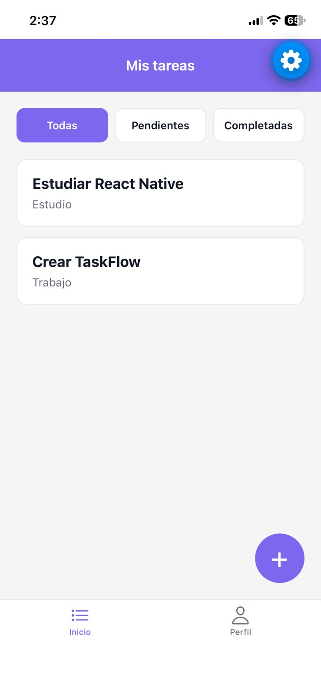
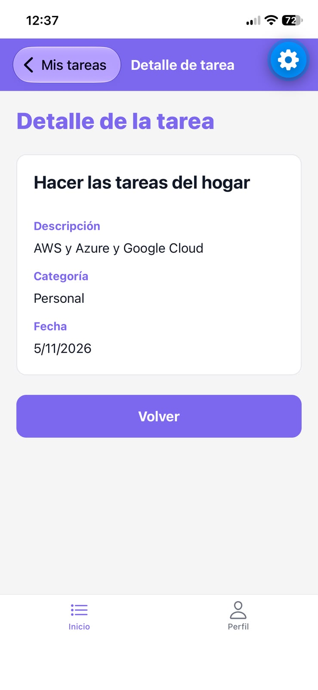
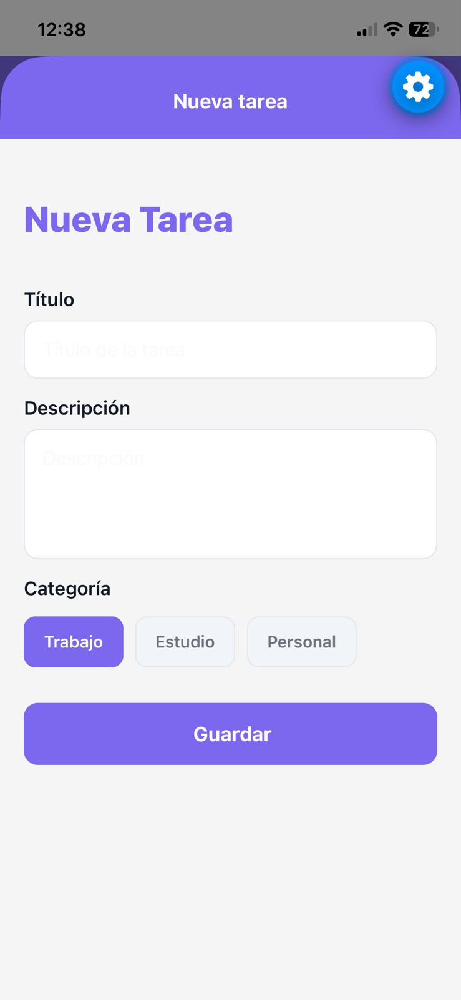
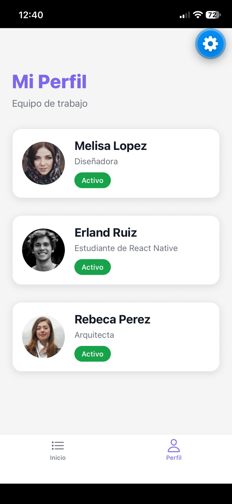
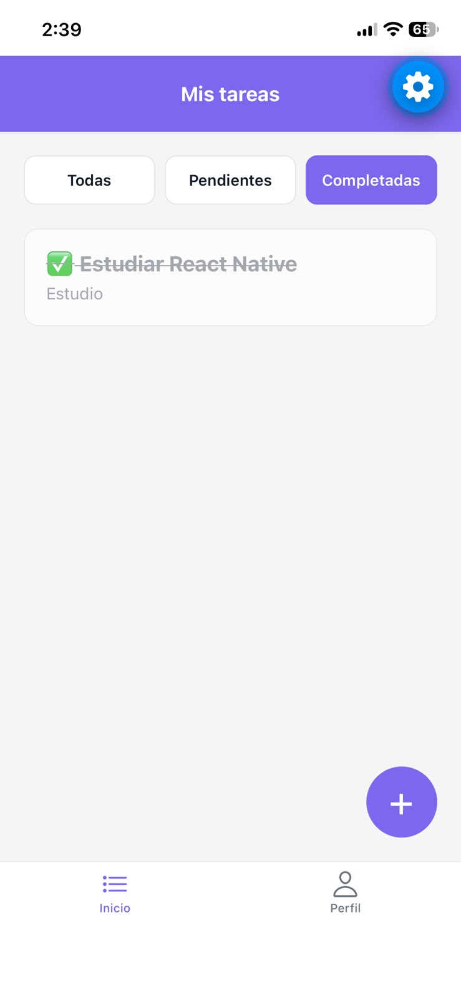
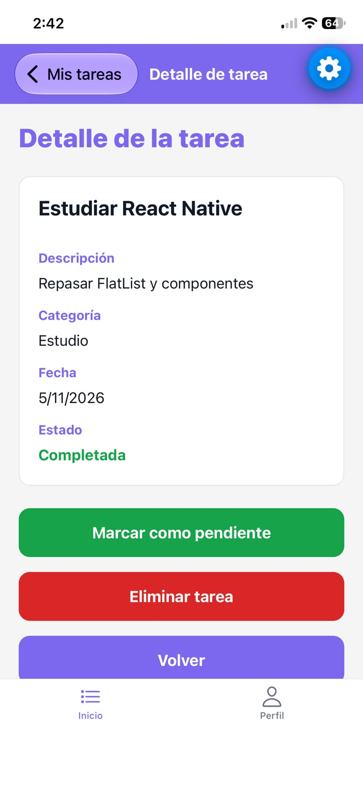
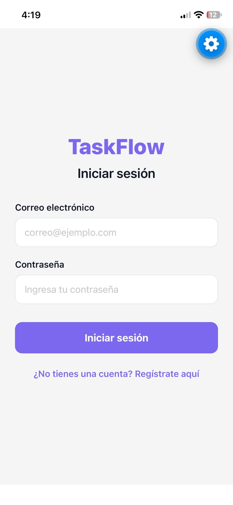
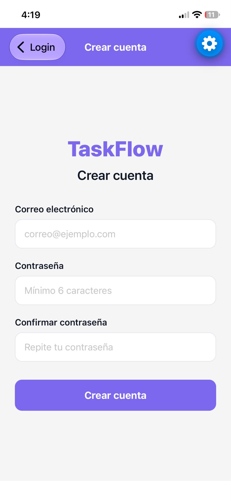
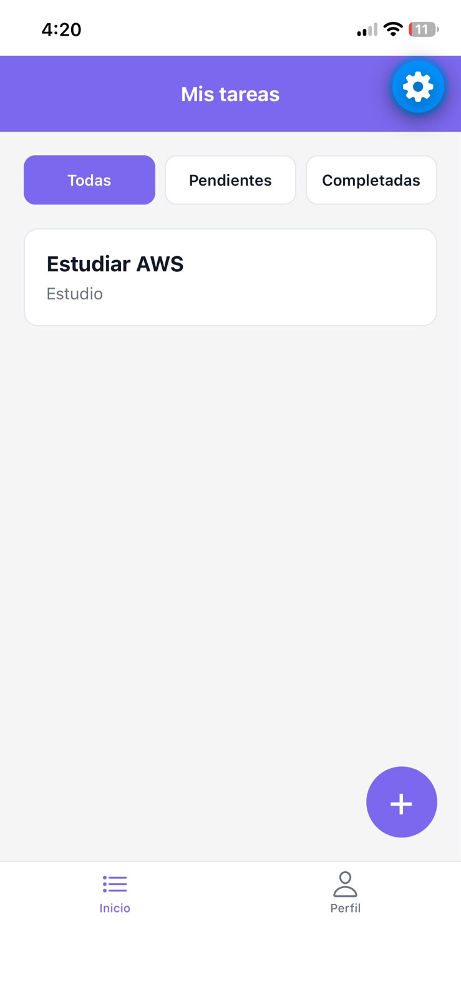
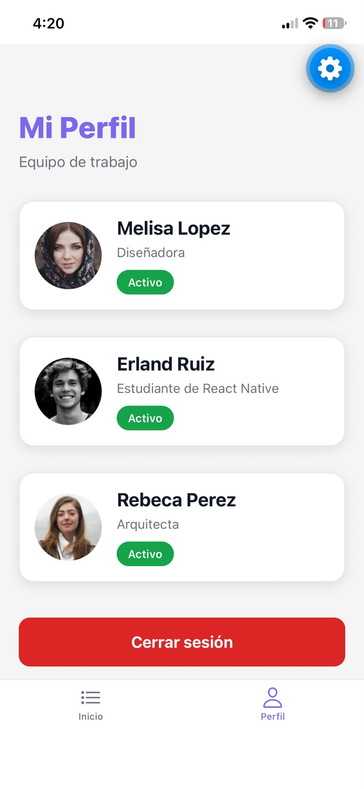

# TaskFlow — Entregas 2, 3, 4, 5, 6 y 7

Aplicación móvil de gestión de tareas desarrollada con **React Native, Expo y TypeScript** para el curso de Desarrollo de Aplicaciones de CoderHouse.

## Objetivo

Desarrollar progresivamente una aplicación móvil que permita crear, validar, visualizar, completar y eliminar tareas, utilizando componentes reutilizables, React Navigation y Redux Toolkit para la administración del estado global.

## Tecnologías utilizadas

- React Native
- Expo
- TypeScript
- React Hooks (`useState`)
- StyleSheet
- FlatList
- TouchableOpacity
- React Navigation
- Native Stack Navigator
- Bottom Tab Navigator
- Expo Vector Icons (Ionicons)
- React Native Safe Area Context
- **Redux Toolkit (`@reduxjs/toolkit`)**
- **React Redux (`react-redux`)**

## Estructura del proyecto

```text
taskflow/
├── docs/
│   └── screenshots/
│       ├── home.jpeg
│       ├── task-detail.jpeg
│       ├── task-form.jpeg
│       └── profile.jpeg
├── src/
│   ├── components/
│   │   ├── ProfileCards.tsx
│   │   ├── TaskForm.tsx
│   │   ├── TaskDetail.tsx
│   │   └── EmptyState.tsx
│   ├── constants/
│   │   ├── theme.ts
│   │   └── types.ts
│   ├── navigation/
│   │   ├── AppNavigator.tsx
│   │   └── TasksStack.tsx
│   ├── screens/
│   │   ├── HomeScreen.tsx
│   │   ├── TaskDetailScreen.tsx
│   │   └── ProfileScreen.tsx
│   └── store/
│       ├── store.ts
│       └── tasksSlice.ts
├── App.tsx
├── package.json
└── README.md
```

## Entrega 2 — Componentes reutilizables

Se implementaron componentes reutilizables y estilos personalizados.

### ProfileScreen

Pantalla de perfiles que utiliza el componente `ProfileCard` para mostrar:

- Nombre del usuario.
- Cargo o rol.
- Imagen de perfil.
- Estado activo o inactivo.

Los colores y estilos globales se organizan en `src/constants/theme.ts`.

## Entrega 3 — Formulario de creación de tareas

Se desarrolló `TaskForm.tsx`, que permite ingresar los datos de una tarea.

### Funcionalidades

- Campo de título y descripción.
- Selección de categoría: Trabajo, Estudio o Personal.
- Manejo del estado de los campos mediante `useState`.
- Validación del título con mínimo 5 caracteres.
- Validación de la descripción con mínimo 10 caracteres.
- Mensajes de error en rojo.
- Bordes personalizados según el foco y los errores.
- Manejo del teclado con `KeyboardAvoidingView` y `ScrollView`.
- Botón Guardar mediante `TouchableOpacity`.

### Validación

La función `handleAddTask` comprueba la información antes de guardar una tarea.

Las validaciones y el diseño del formulario se conservan en las entregas posteriores.

## Entrega 4 — Lista, estado vacío y detalle de tareas

Se amplió TaskFlow para visualizar tareas y consultar su información completa.

### HomeScreen

Se implementó una lista dinámica mediante `FlatList`, utilizando `keyExtractor` para identificar cada tarea.

### EmptyState

Cuando no existen tareas en la vista seleccionada, se muestra un mensaje de estado vacío.

### TaskDetail

El componente de detalle permite visualizar:

- Título de la tarea.
- Descripción.
- Categoría.
- Fecha de creación.
- Botón para regresar.

### Integración

En esta entrega se implementó la creación de tareas y su incorporación a la lista mediante actualizaciones inmutables del estado local.

## Entrega 5 — Navegación con React Navigation

Se integró React Navigation para organizar las pantallas de TaskFlow.

### Bottom Tab Navigator

El archivo `src/navigation/AppNavigator.tsx` configura dos pestañas principales:

- **Home:** permite acceder a la lista y al flujo de gestión de tareas.
- **Profile:** permite visualizar la pantalla de perfiles.

Las pestañas utilizan iconos de `Ionicons` y los colores definidos en `theme.ts`.

### Native Stack Navigator

El archivo `src/navigation/TasksStack.tsx` configura tres rutas:

- **TaskList:** muestra la lista mediante `HomeScreen`.
- **TaskDetail:** muestra la tarea seleccionada mediante `TaskDetailScreen`.
- **TaskForm:** presenta el formulario de creación como pantalla modal.

### Estructura de navegación

```text
App.tsx
   │
   ▼
AppNavigator
   │
   ├── Home
   │    │
   │    ▼
   │   TasksStack
   │    │
   │    ├── TaskList
   │    ├── TaskDetail
   │    └── TaskForm
   │
   └── Profile
        │
        ▼
      ProfileScreen
```

### Paso de parámetros

Al seleccionar una tarea en `HomeScreen`, se utiliza `navigation.navigate()` para enviar únicamente su ID:

```tsx
navigation.navigate("TaskDetail", {
  id: task.id,
});
```

`TaskDetailScreen` recibe el ID mediante `route.params`.

En la Entrega 05, buscaba la tarea en el estado compartido de `TasksStack`; desde la Entrega 06, la consulta directamente en Redux.

### Redirección programática

Al guardar una tarea válida, se ejecuta:

```tsx
navigation.navigate("TaskList");
```

Esto permite regresar automáticamente a la lista.

### Evolución del estado

En la Entrega 05, `TasksStack.tsx` administraba el arreglo de tareas mediante `useState` y lo compartía mediante props.

En la Entrega 06, esta arquitectura fue reemplazada por Redux Toolkit, dejando `TasksStack` encargado principalmente de la navegación.

## Entrega 6 — Migrando TaskFlow al Estado Global con Redux Toolkit

Se implementó **Redux Toolkit** para centralizar el estado de las tareas y los filtros.

El objetivo es evitar la duplicación de datos entre pantallas y mantener una única fuente de información para toda la aplicación.

### 1. Configuración del Store global

Se creó el archivo:

`src/store/store.ts`

Utiliza `configureStore` para registrar el reducer de tareas:

```tsx
export const store = configureStore({
  reducer: {
    tasks: tasksReducer,
  },
});
```

También se definieron los tipos `RootState` y `AppDispatch` para trabajar con TypeScript.

### 2. Integración del Provider

En `App.tsx`, se integró el componente `Provider` de React Redux para permitir que las pantallas accedan al Store global.

```tsx
<Provider store={store}>
  <SafeAreaProvider>
    <SafeAreaView style={styles.container}>
      <AppNavigator />
    </SafeAreaView>
  </SafeAreaProvider>
```

### 3. Creación de tasksSlice

Se creó:

`src/store/tasksSlice.ts`

Este archivo utiliza `createSlice` para administrar las tareas y el filtro actual.

El estado global contiene:

- `tasks`: arreglo de tareas.
- `filter`: criterio de filtrado seleccionado.

Los filtros disponibles son:

- `all`: Todas.
- `pending`: Pendientes.
- `completed`: Completadas.

### 4. Reducers implementados

| Reducer | Funcionalidad |
|---|---|
| `addTask` | Agrega una tarea y genera un identificador único mediante `nanoid`. |
| `toggleTaskStatus` | Cambia el estado de una tarea entre pendiente y completada. |
| `deleteTask` | Elimina una tarea utilizando su ID. |
| `setFilter` | Actualiza el filtro global seleccionado. |

Redux Toolkit utiliza Immer para permitir actualizaciones del estado de manera inmutable.

### 5. Integración con HomeScreen

La pantalla `HomeScreen.tsx` utiliza `useSelector` para obtener las tareas y el filtro global.

```tsx
const { tasks, filter } = useSelector(
  (state: RootState) => state.tasks
);
```

La lista muestra las tareas correspondientes al filtro seleccionado:

- **Todas:** muestra todas las tareas.
- **Pendientes:** muestra únicamente las tareas no completadas.
- **Completadas:** muestra únicamente las tareas completadas.

El filtro se actualiza mediante:

```tsx
dispatch(setFilter(item));
```

Cuando una tarea se completa, su título aparece tachado y se muestra el símbolo ✅.

### 6. Integración con TaskForm

El formulario conserva sus validaciones y utiliza `useDispatch` para guardar tareas directamente en Redux.

```tsx
dispatch(
  addTask({
    title: title.trim(),
    description: description.trim(),
    category,
  })
);
```

El Slice genera automáticamente el ID, la fecha de creación y el estado inicial pendiente.

Después del guardado, el formulario muestra una confirmación y regresa a `TaskList`.

### 7. Integración con TaskDetailScreen

La pantalla de detalle recibe únicamente el ID de la tarea mediante React Navigation.

Luego utiliza `useSelector` para buscar la información directamente en el Store global:

```tsx
const task = useSelector((state: RootState) =>
  state.tasks.tasks.find((item) => item.id === id)
);
```

Desde esta pantalla es posible:

- Visualizar la información completa de la tarea.
- Marcar una tarea como completada.
- Volver a marcarla como pendiente.
- Eliminarla previa confirmación.
- Regresar a Home.

El estado se modifica mediante:

```tsx
dispatch(toggleTaskStatus(id));
```

La eliminación se realiza mediante:

```tsx
dispatch(deleteTask(id));
```

Los cambios se reflejan automáticamente en la lista principal.

### 8. Persistencia del filtro entre pestañas

Uno de los requisitos principales de la Entrega 06 es conservar el filtro seleccionado al navegar entre Home y Profile.

Esta funcionalidad se implementó almacenando `filter` dentro del Store global de Redux.

**Prueba realizada:**

1. Seleccionar el filtro Completadas en Home.
2. Navegar a Profile.
3. Regresar a Home.
4. Verificar que Completadas continúa seleccionado.

**Resultado obtenido:** el filtro se conserva correctamente.

### 9. Modelo de datos actualizado

El tipo `Task` se define en `src/constants/types.ts`:

```tsx
export type Task = {
  id: string;
  title: string;
  description: string;
  category: string;
  createdAt: string;
  completed: boolean;
};

export type TaskFilter =
  | "all"
  | "completed"
  | "pending";
```

La propiedad `createdAt` almacena la fecha como un string ISO y `completed` indica el estado de la tarea.

Este modelo utiliza valores serializables compatibles con Redux Toolkit.

### 10. Arquitectura de Redux

```text
App.tsx
   │
   ▼
Redux Provider
   │
   ▼
Redux Store
   │
   └── tasksSlice
        │
        ├── tasks[]
        ├── filter
        ├── addTask
        ├── toggleTaskStatus
        ├── deleteTask
        └── setFilter
              │
              ▼
         Pantallas
              │
              ├── HomeScreen
              │    ├── useSelector
              │    └── dispatch(setFilter)
              │
              ├── TaskForm
              │    └── dispatch(addTask)
              │
              └── TaskDetailScreen
                   ├── useSelector
                   ├── dispatch(toggleTaskStatus)
                   └── dispatch(deleteTask)
```

### 11. Almacenamiento

Las tareas se mantienen en memoria dentro del Redux Store.

Esta versión no utiliza una base de datos, API externa ni almacenamiento persistente.

Por lo tanto, las tareas creadas no se conservan después de reiniciar completamente la aplicación.

El filtro se mantiene al navegar entre pestañas, pero no necesariamente después de reiniciar la aplicación.

## Evidencias visuales — Entrega 5

Las siguientes capturas fueron realizadas en un iPhone utilizando Expo Go.


### 1. Pantalla principal — Home

Lista de tareas y navegación mediante pestañas.



### 2. Detalle de tarea — TaskDetail

Visualización de la información de una tarea seleccionada.



### 3. Formulario — TaskForm

Creación de tareas con validaciones y selección de categoría.



### 4. Perfiles — Profile

Pantalla de perfiles accesible desde Bottom Tab Navigator.




## Evidencias visuales — Entrega 6

Las siguientes capturas fueron realizadas en un iPhone
utilizando Expo Go.

### 1. Filtro de tareas completadas

La pantalla Home utiliza Redux Toolkit para mostrar
las tareas completadas mediante el filtro global.



### 2. Detalle de una tarea completada

La pantalla de detalle permite consultar el estado
de la tarea y modificarlo mediante Redux Toolkit.

También incluye desplazamiento vertical con ScrollView
para visualizar correctamente las descripciones largas
y los botones de acción.




## Ejecución local

1. Clonar el repositorio.
2. Instalar las dependencias:

   ```bash
   npm install
   ```

3. Iniciar Expo:

   ```bash
   npx expo start
   ```

4. Abrir Expo Go en un dispositivo compatible y escanear el código QR.

### Dependencias de Redux Toolkit

Las dependencias agregadas en la Entrega 06 son:

```bash
npm install @reduxjs/toolkit react-redux
```

## Verificación de TypeScript

Para comprobar los tipos del proyecto:

```bash
npx tsc --noEmit
```

**Resultado:** verificación completada sin errores de TypeScript.

## Pruebas funcionales

### Entregas anteriores

- Visualización de la lista de tareas.
- Navegación entre Home y Profile.
- Apertura del detalle al seleccionar una tarea.
- Regreso mediante la navegación del Stack.
- Apertura del formulario de creación.
- Validación de campos.
- Redirección automática a TaskList.

### Entrega 06 — Redux Toolkit

Se realizaron pruebas en Expo Go para comprobar:

- Creación de tareas mediante `dispatch(addTask)`.
- Visualización de tareas desde Redux.
- Marcado de tareas como completadas mediante `toggleTaskStatus`.
- Actualización visual de tareas completadas.
- Filtrado de tareas por su estado.
- Conservación del filtro Completadas al navegar entre Home y Profile.
- Eliminación de tareas mediante `deleteTask`.
- Regreso a la lista después de eliminar una tarea.
- Verificación de tipos mediante TypeScript.

**Resultado:** las funcionalidades anteriores se probaron correctamente en el dispositivo.

## Organización de ramas de Git

- `main`: Entrega 2 — Componentes reutilizables.
- `feature/add-task-form`: Entrega 3 — Formulario con validaciones.
- `feature/task-list-detail`: Entrega 4 — Lista, estado vacío y detalle.
- `feature/task-navigation`: Entrega 5 — Navegación con React Navigation.
- `feature/redux-task-state`: Entrega 6 — Estado global con Redux Toolkit.

## Estado del proyecto

**Entrega 06:** Redux Store, tasksSlice, filtros globales, creación, actualización y eliminación de tareas implementados y probados localmente en Expo Go.

Proyecto desarrollado como parte del curso de Desarrollo de Aplicaciones de CoderHouse.


## Entrega 7 — Autenticación y Persistencia con Firebase

Se integraron Firebase Authentication y Cloud Firestore
para gestionar usuarios y almacenar las tareas en la nube.

### Tecnologías incorporadas

- Firebase SDK (`firebase`)
- Firebase Authentication
- Cloud Firestore
- AsyncStorage para persistencia de sesión
- Redux Toolkit para sincronización del estado global

### Autenticación

- Registro mediante correo electrónico y contraseña.
- Inicio de sesión mediante Firebase Authentication.
- Cierre de sesión desde Profile.
- Recuperación automática de sesión con `onAuthStateChanged`.
- Protección de las pantallas para usuarios no autenticados.

### Persistencia de tareas

Las tareas se guardan en la colección `tasks` de Cloud Firestore.

Cada tarea contiene un campo `userId` que identifica
a su propietario.

Se implementaron las operaciones:

- Crear tareas.
- Consultar tareas por usuario.
- Marcar tareas como completadas o pendientes.
- Eliminar tareas.

### Sincronización con Redux

Se utiliza `onSnapshot` para recuperar los cambios
de Firestore en tiempo real y actualizar el estado
global mediante `setTasks`.

### Seguridad

Las reglas de Firestore verifican el UID del usuario
autenticado para restringir el acceso a sus propias tareas.

### Pruebas realizadas en Expo Go (iPhone)

1. Registro exitoso de un usuario en Firebase.
2. Inicio de sesión y acceso a Home.
3. Cierre de sesión y regreso a Login.
4. Recuperación automática de sesión al reiniciar.
5. Creación de tareas y verificación en Firebase Console.
6. Actualización del campo `completed` a `true`.
7. Eliminación de tareas en Home y Firestore.
8. Recuperación de tareas después de cerrar la aplicación.
9. Verificación de que distintos usuarios ven sus propias tareas.
10. Verificación de TypeScript con `npx tsc --noEmit`.

### Resultado

Las funcionalidades principales de autenticación,
navegación protegida y persistencia en Firestore
fueron implementadas y probadas en Expo Go.

Las pruebas de funcionamiento sin conexión a Internet
quedan pendientes.


## Evidencias visuales — Entrega 07

Capturas realizadas en un iPhone utilizando Expo Go.

### 1. Inicio de sesión — Login

Pantalla de autenticación con correo electrónico
y contraseña mediante Firebase Authentication.



### 2. Registro de usuarios — Register

Formulario de registro de usuarios utilizando
Firebase Authentication.



### 3. Tareas sincronizadas — Cloud Firestore

Pantalla Home mostrando las tareas recuperadas
desde Firestore y los filtros de Redux Toolkit.



### 4. Perfil y cierre de sesión

Pantalla Profile con la opción Cerrar sesión,
implementada mediante Firebase Authentication.



